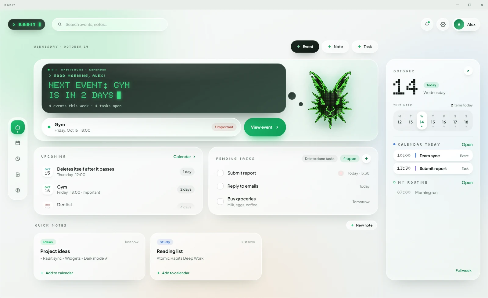
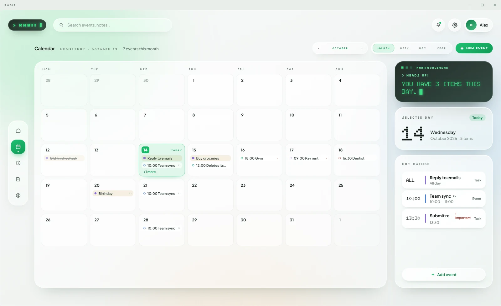
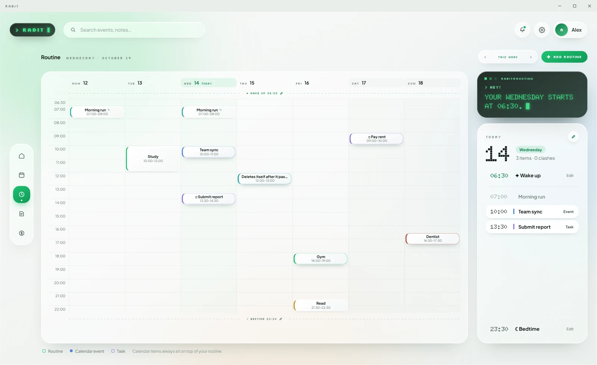
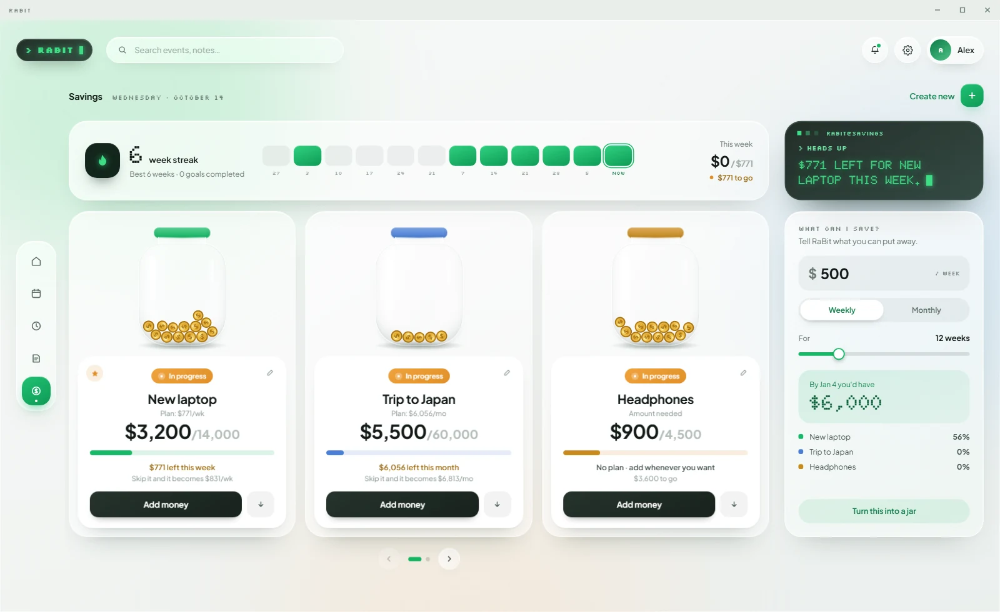
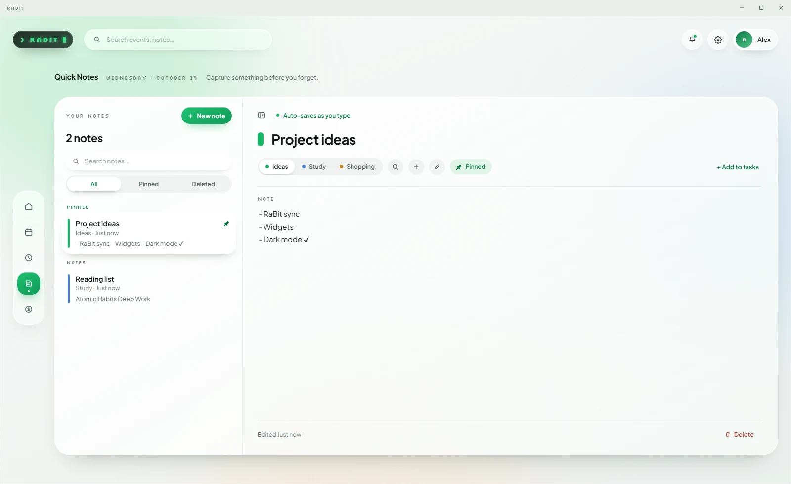

<div align="center">
  
  <h1>RaBit</h1>
  <p><b>A local-first desktop organizer for tasks, events, notes and routine.</b><br>
  No account. No cloud. No ads. No paywall.</p>
  <p><a href="https://github.com/UrielOrtizv1000/RaBit/releases/latest/download/RaBit-Setup.exe"><b>Download for Windows</b></a>
  · <a href="https://github.com/UrielOrtizv1000/RaBit/releases/latest/download/RaBit-x86_64.AppImage"><b>Download for Linux (AppImage)</b></a>
  · <a href="https://github.com/UrielOrtizv1000/RaBit/releases/latest">All releases</a></p>
  <p>
    <a href="https://github.com/UrielOrtizv1000/RaBit/actions/workflows/ci.yml"></a>
    <a href="https://github.com/UrielOrtizv1000/RaBit/releases"></a>
    <a href="LICENSE"></a>
    
    
  </p>
  <p>
    <picture>
      <source media="(prefers-color-scheme: dark)" srcset="docs/assets/screenshots/home-dark.webp">
      
    </picture>
  </p>
</div>

---

## Why this exists

I kept bouncing between organizers that put an ad in front of everything or
asked me to subscribe for features a to-do list should just have. So I built
the one I wanted: it lives on your machine, stores everything in a local
SQLite file, and has nobody to sell your data to — because it never leaves
your computer.

**RaBit is free, and it stays free.** No ads, no tiers, no "pro" upsell.

## Status: beta, in active development

This is version **0.1.0**, heading for **0.2.0** (automatic updates and a new installer). It is functional and it is
what I use, but it is not finished. Windows is the platform I build and test on; Linux (x86_64) builds are new and less tested.

**Working today**

- Onboarding (pick a name, switch modules on or off)
- **Home** — today's events, pending tasks, quick capture
- **Calendar** — month, week, day and year views, click a slot to create
- **Routine** — recurring blocks tied to the real calendar, with clash detection
- **Quick Notes** — tags, pinning, and a 30-day trash you can restore from
- A shared detail panel for events, notes and tasks (autosave, cancel/undo)
- **Savings** — goals as glass jars with moving coins, a weekly streak, a plan that RaBit recalculates after every deposit or withdrawal, and a "what can I save?" calculator
- **Settings** — theme, language, text size, JSON export/import, sample data
- A bell with what is pending today, a short first-run tutorial (plus a one-time hint per page), light and dark themes, English and Spanish
- **Automatic updates** — signed releases from GitHub, installed with one click (see [Updates](#updates))

**Not done yet**

- Reminders and sound — the switches are in Settings but disabled ("in development")
- **Routine** is still in beta
- Code signing — the installer is not signed yet, so Windows SmartScreen may warn the first time
- Real dark theme — the preference is saved, the palette is still being worked on
- Sync and accounts are deliberately out of scope for now.
  The `SyncProvider` interface exists so a backend can be dropped in later
  without touching the rest of the app.

## A look inside

Everything below is the real app with its built-in sample data (Settings → Try RaBit), in the light and dark themes — your
browser picks the one that matches GitHub's theme.

<table>
  <tr>
    <td width="50%">
      <picture>
        <source media="(prefers-color-scheme: dark)" srcset="docs/assets/screenshots/calendar-dark.webp">
        
      </picture>
      <p align="center"><b>Calendar</b> — month, week, day and year</p>
    </td>
    <td width="50%">
      <picture>
        <source media="(prefers-color-scheme: dark)" srcset="docs/assets/screenshots/routine-dark.webp">
        
      </picture>
      <p align="center"><b>Routine</b> — weekly blocks; the calendar always wins a clash</p>
    </td>
  </tr>
  <tr>
    <td width="50%">
      <picture>
        <source media="(prefers-color-scheme: dark)" srcset="docs/assets/screenshots/savings-dark.webp">
        
      </picture>
      <p align="center"><b>Savings</b> — goals as jars, a weekly streak and a plan</p>
    </td>
    <td width="50%">
      <picture>
        <source media="(prefers-color-scheme: dark)" srcset="docs/assets/screenshots/notes-dark.webp">
        
      </picture>
      <p align="center"><b>Quick Notes</b> — tags, pinning and a 30-day trash</p>
    </td>
  </tr>
</table>

## How this was built

RaBit is an AI-assisted project and I would rather say so than have you guess
from the commit history.

- **Claude** produced the original UI/UX mockups (the `.dc.html` files in
  `docs/design/`) and a substantial part of the implementation.
- **Hermes** has acted as the coding agent — repository setup, refactors,
  documentation, and the QA pass that produced `docs/QA.md`.
- I direct the project, review every change, decide what ships, and test it
  myself. The architecture, the data model and the standards are mine.

The result is honest, tested work, but you will find the fingerprints of an AI
pair throughout. Judge it on that basis.

## Tech stack

Tauri 2 (Rust shell) + React 18 + strict TypeScript + Vite. State with Zustand,
persistence in SQLite through `tauri-plugin-sql` with versioned migrations
(`sql.js` in the browser for development and end-to-end tests). Framer Motion
for the animations. Quality gate: Vitest (logic, persistence, i18n coverage),
Playwright (end-to-end), oxlint, Prettier and `tsc --noEmit`.

## Install on Linux

Each release carries three files for x86_64 (built on Ubuntu 22.04, so it needs a distro at least that recent, with WebKitGTK 4.1):

| File                    | For                          | Updates itself            |
| ----------------------- | ---------------------------- | ------------------------- |
| `RaBit-x86_64.AppImage` | any distro (`chmod +x`, run) | yes, from inside the app  |
| `RaBit-x86_64.deb`      | Debian, Ubuntu, Mint         | no — download the new one |
| `RaBit-x86_64.rpm`      | Fedora, openSUSE             | no — download the new one |

`SHA256SUMS-linux.txt` in the same release lets you verify the download (`sha256sum -c SHA256SUMS-linux.txt`). Reminder notifications
need a notification daemon; GNOME and KDE have one. ARM64 builds are not published yet.

## Getting started

Requirements: Node 20+, npm, a stable Rust toolchain (`rustup`) and the Tauri 2
system dependencies for your platform. No environment variables, no secrets, no API keys.

- **Windows:** the Microsoft C++ Build Tools and WebView2.
- **Linux (Debian/Ubuntu 22.04+):**
  `sudo apt install build-essential curl wget file patchelf libssl-dev libwebkit2gtk-4.1-dev libgtk-3-dev libayatana-appindicator3-dev librsvg2-dev`.
  Fedora: `sudo dnf install webkit2gtk4.1-devel gtk3-devel libappindicator-gtk3-devel librsvg2-devel openssl-devel patchelf @c-development`.
  Arch: `sudo pacman -S webkit2gtk-4.1 gtk3 libayatana-appindicator librsvg openssl patchelf base-devel`.
  Reminders use desktop notifications, so a notification daemon (`libnotify`) should be running; GNOME and KDE already have one.

```bash
npm install
npm run tauri dev      # the desktop app, in development mode
npm run dev            # frontend only, in a browser (sql.js + localStorage)
npm run demo           # browser with sample data (?seed)
npm run screenshots    # regenerates docs/assets/screenshots/ (README images)

npm run typecheck      # strict TypeScript
npm run lint           # oxlint
npm run format:check   # Prettier
npm test               # Vitest
npm run test:e2e       # Playwright
npm run package        # builds installers/ (RaBit-Setup.exe on Windows; AppImage, .deb, .rpm on Linux)
```

`http://localhost:1420/?seed` loads sample data in development. In an installed
build, use **Settings → Try RaBit**.

Step-by-step manual checks live in [`docs/TESTING.md`](docs/TESTING.md).

## Updates

Installed copies update themselves: the app checks quietly and, when there is a new version, shows a download icon next to the bell. One click
downloads it in the background, and **Restart to update** installs it with your data intact (a backup of the database is made first). How releases
are signed and published: [`docs/UPDATES.md`](docs/UPDATES.md).

## Where your data lives

A single SQLite file, `rabit.db`, in the per-platform app data directory:

| Platform | Path                                                       |
| -------- | ---------------------------------------------------------- |
| Windows  | `%APPDATA%\app.rabit.desktop\rabit.db`                     |
| macOS    | `~/Library/Application Support/app.rabit.desktop/rabit.db` |
| Linux    | `~/.config/app.rabit.desktop/rabit.db`                     |

In the browser (development and tests only) the same SQL schema is kept in
`localStorage`. To move your data, use **Settings → Data → Export / Import**
(a plain `.json` file).

## Privacy and security

RaBit collects nothing. There is no telemetry, no analytics and no crash
reporting. The only network request is the update check: it asks GitHub for the
`latest.json` of the newest release (a version number and a signature, nothing
about you) and downloads a signed installer only when you click **Update**. The
Tauri window ships a restrictive CSP, every SQL query is parameterised, and
errors are logged through `src/lib/log.ts` without personal data. See
[`SECURITY.md`](SECURITY.md).

## Project layout

```
src/domain      pure business rules (no React, no DB)   src/lib         swipe, zoom, log
src/db          SQL, migrations, repository             src/components  ui/ and the shared ItemPanel/
src/store       Zustand (data + UI state)               src/features    home, calendar, routine, notes, savings, settings, onboarding
src/services    boot, reminders, backup, sample data    src/app         shell, dock, FitPage
src/i18n        t() plus Spanish dictionaries           src-tauri       Tauri 2 shell (Rust)
tests/          Vitest and Playwright                   docs/           architecture, testing, QA, design mockups
scripts/        demo, packaging, release checks, QA
```

Mobile clients live beside the desktop app and share no code with it, only the
contract in [`shared/`](shared) (SQLite schema, backup format, design tokens):

```
ios/            RaBitIOS — SwiftUI (not started)        android/        RaBitAndroid — Kotlin + Compose (not started)
shared/         schema, backup format, tokens, fixtures
```

The reasoning behind the layering — and how to extend the app without breaking
it — is in [`docs/ARCHITECTURE.md`](docs/ARCHITECTURE.md).

## Contributing

Fork it, branch off `main`, and open a pull request. Conventional Commits,
passing tests, and no secrets in the diff. [`CONTRIBUTING.md`](CONTRIBUTING.md)
has the details.

## License

RaBit is free software, released under the **GNU General Public License v3.0**
(see [`LICENSE`](LICENSE)). You can use it, study it, change it and share it.
If you distribute a modified version, it has to stay under the same license and
keep the original authorship and copyright intact — RaBit stays RaBit, and it
stays mine. That is the whole point of picking a copyleft license over a
permissive one.

Copyright (C) 2026 Uriel Ortiz.
